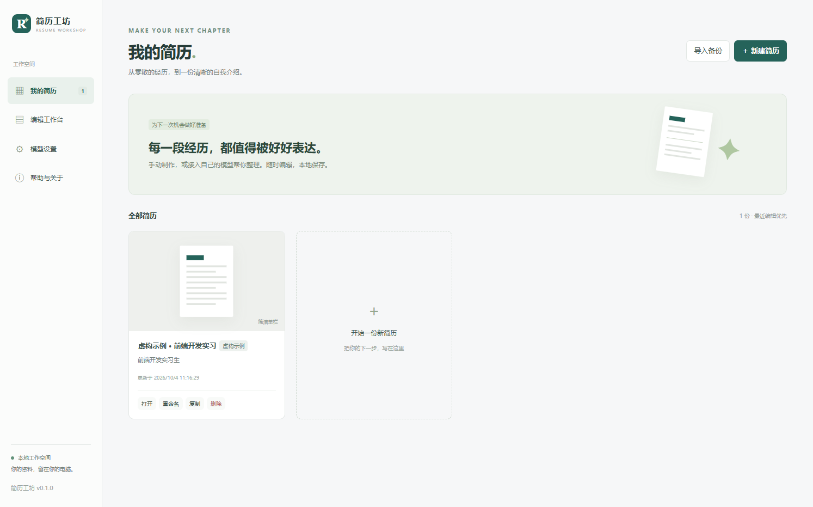
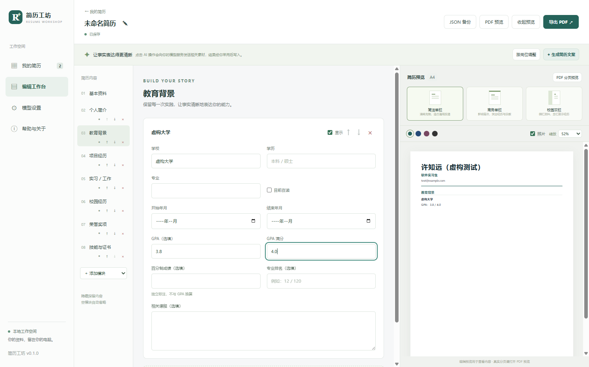

# 简历工坊 · 简历自动生成 Agent

面向大学生、应届生与实习求职者的中文 Windows 桌面应用。资料留在本地，用户自行配置兼容聊天接口的模型；无需模型密钥也能制作和导出简历。

当前版本：0.1.0 · MIT 许可。源码：[GitHub](https://github.com/irissheep/resume-workshop) · 下载：[Releases](https://github.com/irissheep/resume-workshop/releases/tag/v0.1.0) · 反馈：[Issues](https://github.com/irissheep/resume-workshop/issues)。

**第一次使用：请按 [逐步使用教程](docs/USER_GUIDE.md) 完成安装、填写、AI 配置、PDF 导出与备份。**

## 功能
- 多份简历：创建、重命名、复制、删除；虚构示例与用户简历独立。
- 资料、教育、项目、实习工作、校园活动、奖项和技能证书；新增、编辑、排序和隐藏。
- 原始关键词、用户确认事实与正式描述分开保存。
- 简洁单栏、商务单栏、校园双栏；主题色、照片开关、缩放和模块顺序。
- 实际 PDF 分页预览和系统保存对话框；PDF 文字可搜索与选择。
- 800ms 防抖自动保存、按序原子写入、关闭前等待保存、保存失败重试。
- JSON 备份与恢复，含照片；导入创建新 ID，使用允许字段，不包含模型密钥。
- 用户自带模型：设置与测试、系统加密密钥、会话密钥、60 秒超时、取消、错误分类。
- 整份文案、最多三个补充问题、单段优化/精简/突出贡献、岗位适配与顺序建议。
- AI 建议先对照，逐项或全部采用；旧修订和跨简历结果不会直接覆盖。

## 本地交付
- 安装包：release/Resume-Workshop-0.1.0-x64.exe。
- ZIP：release/Resume-Workshop-0.1.0-x64.zip，解压后运行 Resume Workshop.exe。
- 校验值：release/SHA256SUMS.txt；实际验证记录：docs/VALIDATION.md。

## 安装与开始使用
1. 从 [GitHub Releases](https://github.com/irissheep/resume-workshop/releases/tag/v0.1.0) 下载 Windows x64 安装包，或使用本地 release 目录的安装包。
2. 运行安装向导，可选择安装位置。无需 Node.js 或 Python。
3. 启动“Resume Workshop”，打开标有“虚构示例”的简历了解界面，或新建空白简历。
4. 填写资料，整理正式描述，打开 PDF 分页预览检查后导出。
5. 需要 AI 时，在“模型设置”填写模型服务地址、模型 ID 和自己的 API Key，保存并测试。

ZIP 版本解压后运行 Resume Workshop.exe。发行包尚未进行代码签名；操作系统的实际提示取决于本机策略，签名与安装信誉需在正式发布时验证。

## 模型接入
按 [DeepSeek 官方文档](https://api-docs.deepseek.com/zh-cn/) 核对服务地址和当前模型 ID；聊天接口前缀可填 https://api.deepseek.com。模型 ID 以当前服务商控制台为准。

应用去除地址末尾斜杠，再追加 /chat/completions；不会自动添加 /v1。不查询模型列表、不依赖流式输出、工具调用或 JSON Schema 模式。其他兼容服务应填写其自己的正确前缀。

远程地址必须使用 HTTPS；localhost、127.0.0.1、::1 回环可使用 HTTP。连接测试不发送简历，可能消耗少量额度。只有主动测试和 AI 操作才发起模型请求，不自动重试。

AI 会收到相关原始素材、已确认事实及岗位文本；请求省略姓名、电话、邮箱、城市、作品链接和照片。单段操作仅发送当前经历与岗位上下文。经历、已确认事实或岗位文本中自行写入的个人信息仍可能随请求发送，请先检查这些文本。提示词无法保证模型不编造，请逐条核对建议。

## 本地数据与备份
发布应用使用 Electron 用户数据目录；模型设置在 model-settings.json，简历在 resumes/<ID>.json，含 schemaVersion。照片以经过验证的 PNG/JPEG 数据保存在本地简历文件内，不依赖原图片路径。

勾选记住密钥后通过 Windows safeStorage 加密；系统加密不可用时仅使用会话密钥，不持久化明文。清除会移除已保存密钥。renderer 不取得已保存的密钥。

备份仅包含当前简历的允许字段、原始输入、文案和照片。支持本应用 schemaVersion 1 JSON，最大 10 MB；照片最大 5 MB、4000 万像素。未知版本、损坏数据、非法图片和重复 ID 会被拒绝。

损坏草稿保持原文件，不静默重置。请先复制文件，再从备份导入新简历。定期备份重要资料。正常关闭等待保存完成；突然断电或强制终止时，最近一次防抖尚未提交的修改仍可能丢失。

## 开发：全部下载留在项目目录
需要 Windows x64、Node.js 24.11.1 或满足 Vite/Vitest 的兼容版本、npm。使用 PowerShell 在项目根目录执行：

    .\scripts\npm.ps1 ci
    .\scripts\npm.ps1 run prepare:electron
    .\scripts\npm.ps1 run dev

统一脚本设置以下目录：
- node_modules/：开发依赖。
- .cache/npm、.cache/electron、.cache/electron-builder、.cache/playwright：下载缓存。
- .cache/temp：TMP/TEMP 与测试文件。
- .local-data：开发草稿、设置、浏览器会话和崩溃目录。
- dist/：生产编译结果；release/：安装包与 ZIP。

项目脚本启用 Node 环境代理；已有 HTTP_PROXY、HTTPS_PROXY、NO_PROXY 按环境设置生效。不会修改系统代理或安装全局依赖。

    .\scripts\npm.ps1 run typecheck
    .\scripts\npm.ps1 run test
    .\scripts\npm.ps1 run build
    .\scripts\npm.ps1 run test:e2e
    .\scripts\npm.ps1 run licenses
    .\scripts\npm.ps1 run dist

Playwright 使用项目内 Electron，不额外下载浏览器。完整端到端测试会启动隐藏窗口，写入虚构数据和 PDF；不会调用真实付费服务。发布版可通过 RESUME_DATA_DIR 环境变量指定数据位置，路径先在应用启动前确定。建议重要数据目录自行备份。

## 结构
- src/main：文件、原生对话框、模型调用、密钥与 PDF。
- src/shared：类型、运行时校验、提示词和输出处理、三个共享 HTML/CSS 模板。
- src/renderer：React 编辑器、自动保存状态、建议对照和预览。
- tests：数据保护单元测试、真实 Electron/HTTP mock/PDF 测试。
- docs：验收记录、截图、第三方许可和 Release 说明。

## 验证与限制
实际执行结果见 [验收报告](docs/VALIDATION.md)。真实模型、另一台无开发环境电脑、安装向导交互与签名信誉必须分别验收，mock 不等于服务兼容性验证。

首版不包含 Word 导出、PDF/DOCX 解析、账号、云同步、招聘平台或其他系统支持。校园双栏模板侧栏固定为简介、技能和奖项，模块顺序在各栏内生效。编辑预览不模拟分页，PDF 预览才是实际分页依据。

## 开源
采用 [MIT](LICENSE) 许可，版权署名使用 Resume Workshop contributors。第三方许可见 [THIRD_PARTY_NOTICES.md](THIRD_PARTY_NOTICES.md) 与 docs/THIRD_PARTY_LICENSES.txt。贡献说明见 [CONTRIBUTING.md](CONTRIBUTING.md)，反馈请使用 [GitHub Issues](https://github.com/irissheep/resume-workshop/issues)。公开内容与排除项见 [隐私检查记录](docs/PRIVACY_REVIEW.md)；请勿上传模型密钥、个人简历、个人照片或本地数据。
